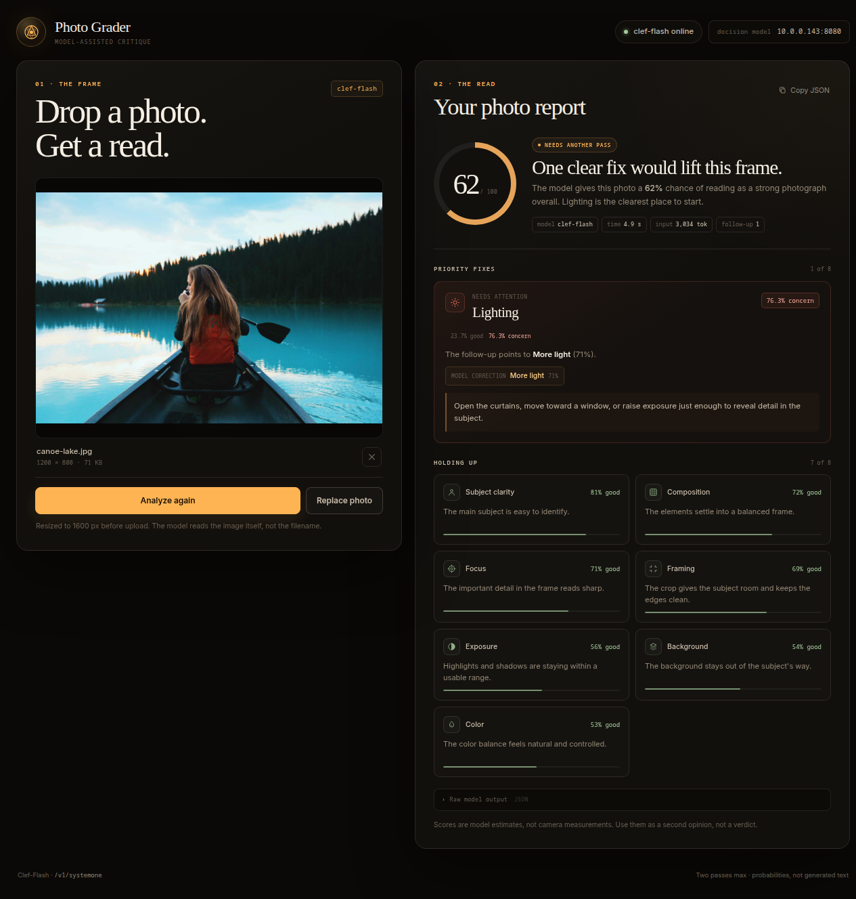

# Photo Grader

A model-assisted photo critique built on the **Clef-Flash** decision model at
`https://sysone.hnasheralneam.dev`. Upload a photograph and get a scored read on lighting,
exposure, framing, focus, composition, color, background, and subject clarity —
with follow-up questions wherever the model thinks something needs work.



## Run

```bash
python3 serve.py
```

Then open <http://127.0.0.1:8089>.

To make it available on your LAN:

```bash
python3 serve.py --bind 0.0.0.0 --port 8089
```

The page calls the llama.cpp server directly. The server enables CORS for the
browser origin, so no proxy is needed.

## How the critique works

Uploading a photo immediately starts a two-pass critique:

1. **Pass one — nine reads in one request.** The model answers eight `noul`
   (yes/no) questions about the photograph plus one overall question. Each
   visual check becomes:

   ```
   concern = 1 - P(good)
   ```

2. **Pass two — only where needed.** Any check with `concern > 50%` gets a
   follow-up `choice` question. All follow-ups are batched into one request with
   the same image. For example, if lighting is flagged, the model is asked
   whether it needs **more light**, **less light**, **softer light**, or a
   **different direction**.

3. **Feedback.** The follow-up's chosen correction selects a concrete piece of
   advice (move toward a window, diffuse the light, crop in, level the horizon,
   and so on). Every check has its own advice map.

The threshold lives at the top of [`app.js`](app.js):

```js
const CONCERN_THRESHOLD = 0.5;
```

The read intro and report both show this 50% rule, so the behavior is visible to
the person using it.

## Checks

| Check | Follow-up when concern is above 50% |
|---|---|
| Lighting | more light, less light, softer light, different direction |
| Exposure | brighten, darken, recover highlights, lift shadows |
| Framing | move closer, step back, reposition subject, straighten |
| Focus | missed focus, motion blur, deeper depth of field, wrong focus area |
| Composition | simplify, rebalance space, change angle, reposition subject |
| Color | warmer, cooler, less saturation, more saturation |
| Background | simplify, blur, move subject, change angle |
| Subject clarity | move closer, isolate, choose a clearer subject, change angle |

The ninth question, overall impact, produces the headline score and does not
need a follow-up. Scores are model estimates, not camera measurements.

## Image handling

- JPG, PNG, WEBP, GIF; 25 MB maximum.
- Resized to a 1600 px longest edge before upload.
- Small JPG/PNG files are sent unchanged; WEBP/GIF inputs are converted to JPEG.
- Images are held in browser memory and sent to the model only when grading.

## Configuration

The server URL is defined at the top of [`app.js`](app.js):

```js
const DEFAULT_SERVER = "https://sysone.hnasheralneam.dev";
```

Override it for a single page load:

```
http://127.0.0.1:8089/?server=https://sysone.hnasheralneam.dev
```

## Files

- [`index.html`](index.html) — page structure
- [`styles.css`](styles.css) — darkroom-inspired layout and report styling
- [`app.js`](app.js) — image prep, two-pass decision logic, feedback rendering
- [`serve.py`](serve.py) — no-cache static file server
- [`docs/screenshot.png`](docs/screenshot.png) — a real critique result

## API shape

Pass one sends:

```json
{
  "state": "This is a photograph submitted for a visual critique…",
  "images": ["data:image/jpeg;base64,..."],
  "questions": {
    "lighting": { "type": "noul", "instructions": "Is the lighting on the main subject good?" },
    "overall": { "type": "noul", "instructions": "Would this photograph read as strong and finished overall?" }
  }
}
```

Pass two sends only the flagged checks as `choice` questions. This uses
llama.cpp's `/v1/systemone` decision endpoint, not chat completions. The model
returns probabilities; the UI supplies the explanatory text.

## Verified with

- `clef-flash` (`Clef-Flash-Q4_K_M.gguf`), llama.cpp `b66-620d222`
- A well-lit photo: 62/100, one lighting fix, seven checks passing
- An underexposed photo: 18/100, five fixes; lighting follow-up chose “more light” at 94%
- All-clear path with no follow-up pass
- Desktop and 390 px mobile layouts
