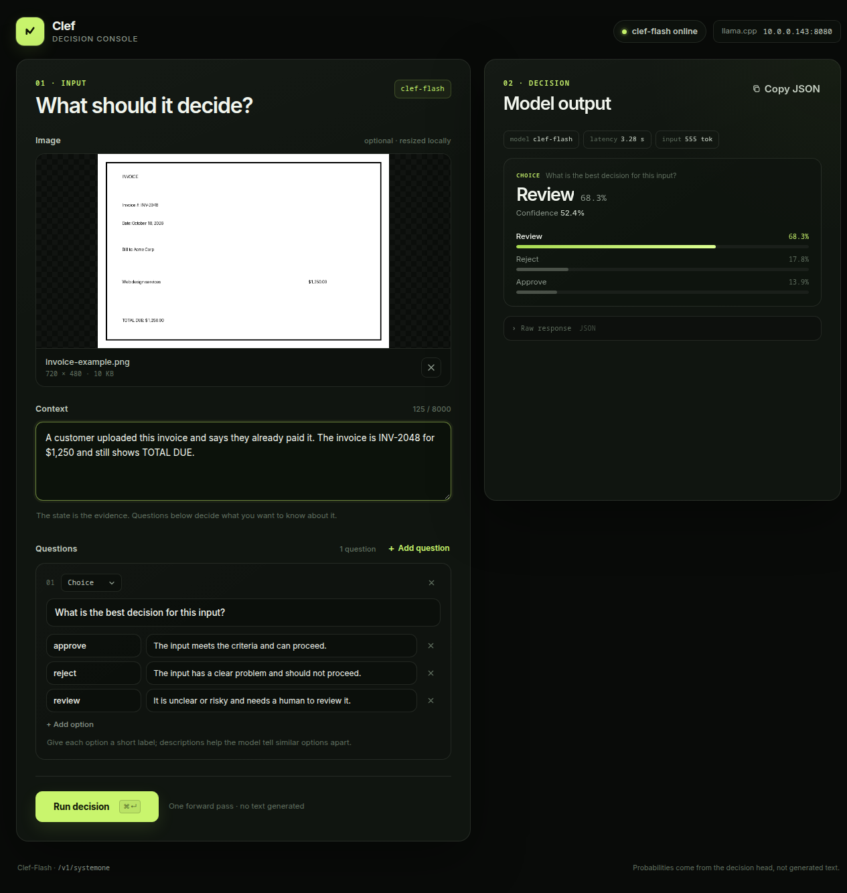

# Clef decision console

A small, dependency-free web UI for the **Clef-Flash** decision model served by
llama.cpp at `http://10.0.0.143:8080`.

It takes an image and/or a text state, lets you define typed decision questions,
and renders the model's probabilities. Everything is one static page — no build
step, package manager, or backend proxy.



## Run

```bash
python3 serve.py
```

Then open <http://127.0.0.1:8088>.

To make it available on your LAN:

```bash
python3 serve.py --bind 0.0.0.0 --port 8088
```

The llama server enables CORS for the browser origin, so the page calls
`http://10.0.0.143:8080/v1/systemone` directly.

## Use

1. Drop, paste, or choose an image. Images are resized to a 1600 px long edge
   before upload; PNG/JPEG files that are already small are sent unchanged.
   WebP and GIF inputs are converted to JPEG.
2. Add context describing the situation or document.
3. Edit the default **Choice** question, or add **Choice**, **Score**, and
   **Yes / no** questions.
4. Press **Run decision** (or `Ctrl`/`Cmd` + `Enter`).

Answers show the selected option with per-option probabilities, the expected
score with its distribution, or the probability of yes. The raw JSON response
can be copied from the output panel.

## Configuration

The server URL is defined at the top of [`app.js`](app.js):

```js
const DEFAULT_SERVER = "http://10.0.0.143:8080";
```

You can override it for a single page load without editing the file:

```
http://127.0.0.1:8088/?server=http://10.0.0.143:8080
```

## How it maps to the API

The UI sends a `POST /v1/systemone` request:

```json
{
  "state": "Context from the text area",
  "images": ["data:image/jpeg;base64,..."],
  "questions": {
    "q1": {
      "type": "choice",
      "instructions": "What is the best decision for this input?",
      "criteria": {
        "approve": "The input meets the criteria and can proceed.",
        "reject": "The input has a clear problem and should not proceed."
      }
    }
  }
}
```

This is the decision-model endpoint, not a chat-completions endpoint: Clef
returns scored options in one forward pass and does not generate free text.

The image is optional; a text-only state works too. If only an image is
provided, the UI sends `"An image was provided."` as the state.

## Files

- [`index.html`](index.html) — page structure
- [`styles.css`](styles.css) — layout and visual design
- [`app.js`](app.js) — image preparation, question editor, API call, result rendering
- [`serve.py`](serve.py) — no-cache static file server
- [`docs/screenshot.png`](docs/screenshot.png) — screenshot of a real request

## Verified with

- `clef-flash` (`Clef-Flash-Q4_K_M.gguf`), llama.cpp `b66-620d222`
- `GET /health`, `GET /v1/models`, `POST /v1/systemone`
- Text and image requests, including an invoice-classification test
